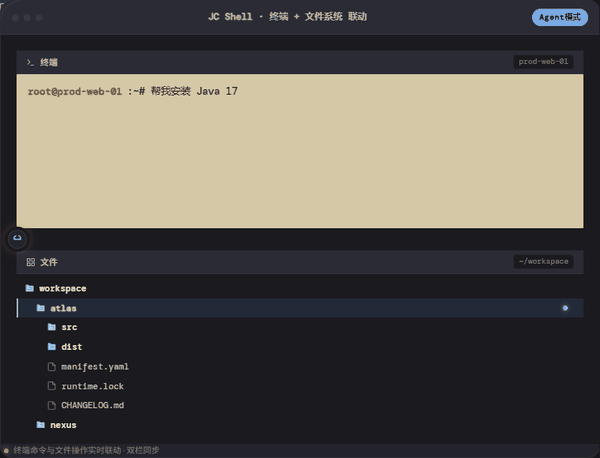
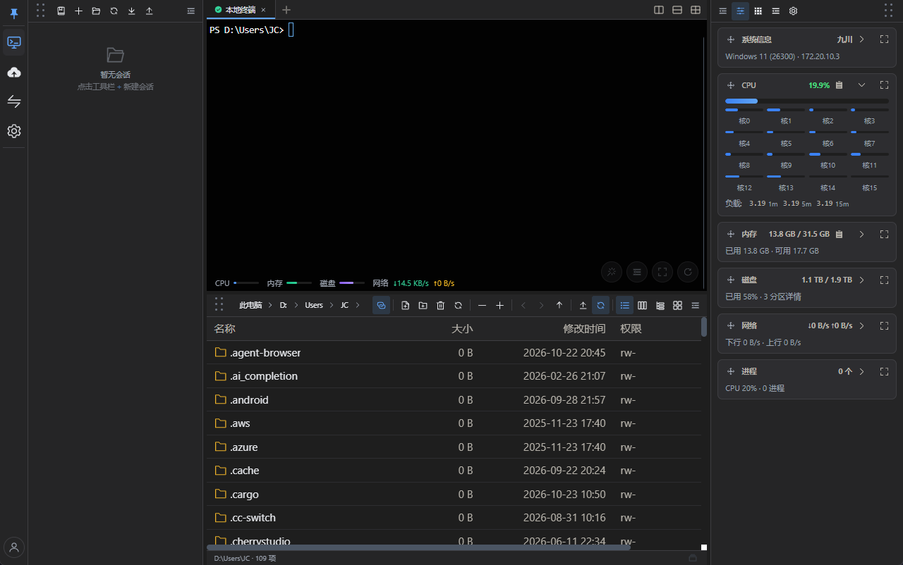
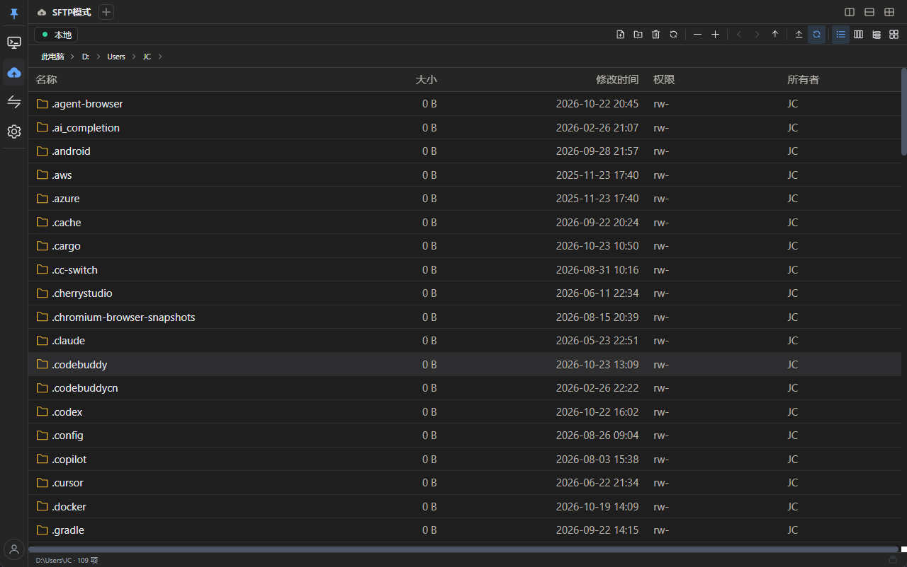
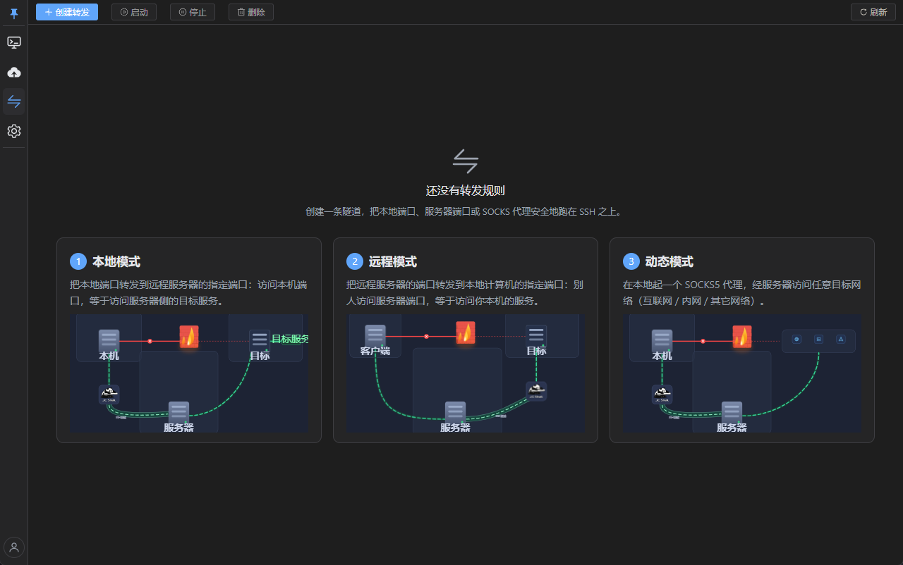
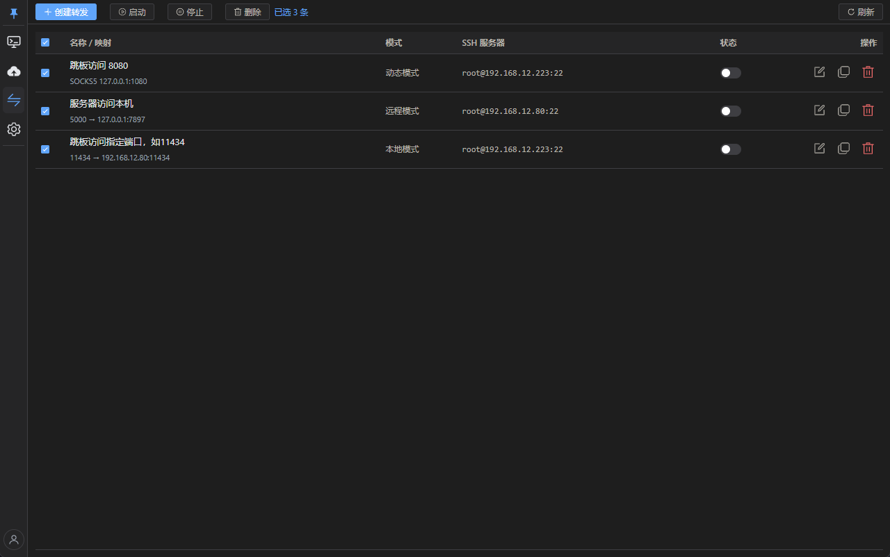
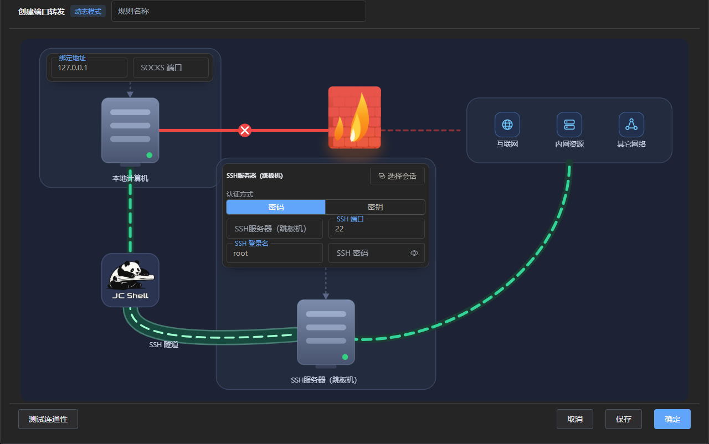
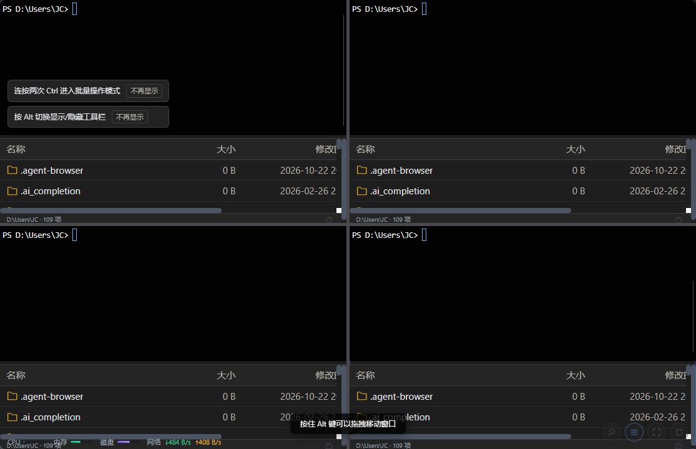
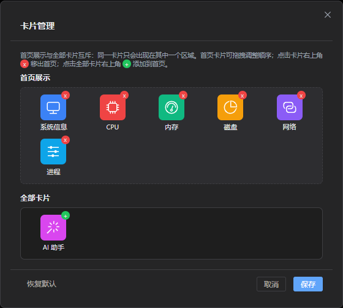
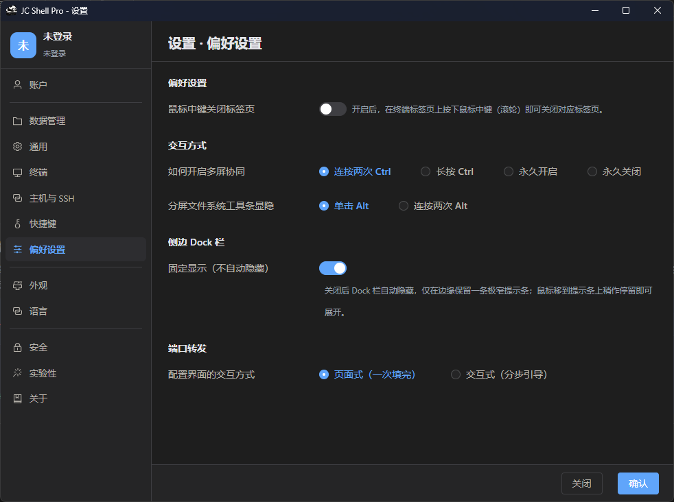

<div align="center">


# JC Shell

**跨平台 SSH 终端 + AI 运维助手**

Windows · macOS · Linux · Android · iOS

<p>
  <a href="#-下载">下载</a> ·
  <a href="#-核心功能">功能</a> ·
  <a href="#-从源码构建">源码构建</a> ·
  <a href="#-技术栈">技术栈</a> ·
  <a href="#-相关链接">相关链接</a>
</p>

</div>

---

## 简介

<div style="display:inline-block;padding:20px 40px;background:#1a1a2e;border-radius:8px;">
  <span style="font-size:48px;font-weight:900;color:#ffffff;letter-spacing:6px;text-align:center;text-shadow:0 0 20px rgba(100,180,255,0.6);font-family:'Microsoft YaHei',sans-serif;">自由 免费 开源 可商用 可二开 可分发</span>
</div>

<p align="center">
  
</p>
JC Shell 是一款面向运维工程师、后端开发者和个人站长的跨平台 SSH 客户端。它将远程终端、图形化文件管理、服务器监控与 AI 运维助手整合在一个客户端中：一套账号、一份主机配置，桌面与移动多端同步，让你随时随地管理自己的服务器。

- **安全**：全程 SSH 加密通道，凭据本地加密存储，密码永不上云
- **高效**：终端与文件管理器同屏联动、批量操作，少敲命令少切换工具
- **跨平台**：Windows / macOS / Linux 桌面端 + Android / iOS 移动端
- **智能**：AI 助手把自然语言变成可执行命令，执行过程全程可见可中断


## 核心功能

| 模块 | 功能 |
|---|---|
| 连接管理 | 主机配置（名称/地址/端口/账号/密码或密钥）、分组、搜索、一键连接 |
| 远程终端 | 完整 SSH 终端：多标签、ANSI 色彩、vim/top 等全屏程序、字体缩放、命令历史 |
| 文件管理 | 基于 SFTP 的图形化管理：浏览、上传下载（拖拽/队列）、在线编辑、新建/重命名/删除、权限修改、目录打包 |
| 分屏协作 | 终端 × 文件管理器上下/左右分屏，分屏间滚动同步、批量界面操作广播 |
| 本机管理 | 本机终端 + 本机文件浏览，本地与远程窗口间拖拽互传 |
| 端口转发 | 基于 SSH 隧道的本地端口转发规则管理（安全访问内网服务） |
| 服务器监控 | CPU / 内存 / 磁盘 / 网络实时曲线，自动刷新 |
| AI 助手 | 自然语言生成命令、分步执行、随时中断、下载卡顿自动切换镜像源重试 |
| 账号同步 | 手机号登录，主机配置云端同步（不含密码），多端一致 |
| 其他 | 系统托盘、自动更新、中英双语、深色/浅色主题、生物识别解锁（移动端） |

## 界面演示

<table>
  <tr>
    <td align="center">主界面</td>
    <td align="center">SFTP</td>
  </tr>
  <tr>
    <td align="center">端口转发-初始页面</td>
    <td align="center">端口转发-列表页面</td>
  </tr>
  <tr>
    <td align="center">创建端口转发规则</td>
    <td align="center">精简模式-分屏模式</td>
  </tr>
  <tr>
    <td align="center">卡片管理（可扩展）</td>
    <td align="center">设置页面</td>
  </tr>
</table>

## 下载

| 平台 | 获取方式 |
|---|---|
| Windows | [Gitee Releases](https://gitee.com/Open-JC/jc-shell/releases) （国内推荐）/ [GitHub Releases](https://github.com/MetaJC/JC-Shell/releases) |
| macOS | 同上 |
| Linux | 同上（deb / rpm / AppImage） |
| Android | 同上（APK） |
| iOS | App Store |

> 官网：<https://www.openjc.cc/jc-shell> ｜ 使用文档：<https://docs.openjc.cc>
>
> 代码签名：Windows 安装包的代码签名由 [SignPath Foundation](https://signpath.org/) 免费提供。

## 从源码构建

### 环境要求

- Node.js 20+
- Rust 1.77+
- 平台工具链：Windows 需 VS 2022 Build Tools（C++）；macOS 需 Xcode；Linux 需 webkit2gtk 等系统依赖

### 命令

```bash
# 安装依赖
npm install

# 桌面端开发调试
npm run tauri:dev

# 打包当前平台安装包
npm run tauri:build:prod

# Android / iOS 首次需初始化工程
npm run tauri:android:init
npm run tauri:ios:init
```

> 环境变量：构建期通过 `.env.production` / `.env.development` 注入后端地址等配置
> （模板见 `.env.example`，复制后按需填写；这些文件不入库）。

## 技术栈

| 层 | 技术 |
|---|---|
| 框架 | Tauri 2 + Rust + Vue 3 + Vite + TypeScript |
| UI | Element Plus + Tailwind CSS |
| 终端 | xterm.js（WebGL 渲染） |
| 编辑器 | CodeMirror 6 |
| SSH / SFTP | russh / russh-sftp（纯 Rust 实现） |
| 存储 | SQLite（sqlx）+ 系统 Keychain（keyring） |
| 加密 | AES-256-GCM（本地数据）、OS Keychain（凭据） |

## 目录结构

本仓库（社区版）完整目录结构（被 `.gitignore` 忽略的构建产物不列出）：

```
jc-shell-community/
├── src/                          # Vue 3 + TypeScript 前端
│   ├── api/                      # Tauri IPC 封装（前端调用 Rust 命令的桥接层）
│   ├── assets/                   # 静态资源（logo.png、jc-shell-logo.png）
│   ├── components/               # 通用组件（终端、文件管理、设置、端口转发、主机列表等）
│   ├── composables/              # 组合式函数（拖拽、快捷键、会话联动、锁屏、窗口注册等 use*.ts）
│   ├── router/                   # 前端路由（hash 模式）
│   ├── stores/                   # Pinia 状态（主机 / 会话 / AI / 同步 / 设置…）
│   ├── styles/                   # 样式文件（mobile.css 等）
│   ├── utils/                    # 工具函数（平台探测 / 版本标识 / 安全等）
│   ├── views/                    # 页面级组件（主窗口 / 锁屏等）
│   ├── App.vue                   # 根组件
│   ├── env.d.ts                  # TypeScript 环境类型声明（.vue 与 Vite 环境变量）
│   ├── main.ts                   # 前端入口（创建并挂载 Vue 应用、Pinia、Router）
│   └── style.css                 # 全局基础样式
├── src-tauri/                    # Rust 后端（Tauri 2）
│   ├── src/                      # Rust 源码（commands / services / repositories / models / common 等子模块）
│   ├── capabilities/             # Tauri 2 权限与能力配置（default.json / mobile.json）
│   ├── icons/                    # 各平台打包图标
│   ├── ios-patches/              # iOS 原生补丁（jc_safearea.mm，安全区适配）
│   ├── windows/                  # Windows 安装器脚本（hooks.nsh）
│   ├── vendor/                   # 补丁依赖的 crate 源码（构建需要，必须入库）
│   ├── build.rs                  # Tauri 构建脚本
│   ├── Cargo.toml                # Rust 依赖与包配置
│   ├── Cargo.lock                # 依赖锁定（必须入库，避免版本漂移）
│   ├── tauri.conf.json           # Tauri 主配置
│   ├── tauri.android.conf.json   # Android 平台配置
│   ├── tauri.ios.conf.json       # iOS 平台配置
│   ├── tauri.ios.prod.conf.json  # iOS 生产环境配置
│   ├── tauri.conf.system.json    # 桌面端系统级配置
│   ├── Info.ios.plist            # iOS 应用 Info.plist
│   ├── app-icon.png              # 应用图标源图
│   ├── app-icon-mobile.png       # 移动端图标
│   ├── app-icon-mobile-src.png   # 移动端图标源图
│   └── taskbar-source.png        # 任务栏图标源图
├── scripts/                      # 构建 / 发布脚本（Node ESM）
│   ├── android-signing.mjs       # Android 签名配置处理
│   ├── android-sign-prod.mjs     # Android 生产签名
│   ├── bump-version.mjs          # 统一提升各清单文件版本号
│   ├── icon-build.mjs            # 由源图生成各平台应用图标
│   ├── icon-store.mjs            # 图标资源整理 / 入库
│   ├── tauri-xcode-env.mjs       # iOS 构建时注入 Xcode 环境
│   └── with-env.mjs              # 加载 .env.* 并注入构建命令
├── .env.example                  # 环境变量模板（后端地址、OAuth 客户端等；真实 .env.* 不入库）
├── .gitignore                    # Git 忽略规则（忽略构建产物，保留 Cargo.lock 与 vendor/）
├── index.html                    # Vite 前端 HTML 入口
├── package.json                  # 前端依赖与 npm 脚本（tauri:dev / tauri:build:prod 等）
├── postcss.config.js             # PostCSS 配置（Tailwind / autoprefixer）
├── tailwind.config.js            # Tailwind CSS 配置（主题与内容扫描范围）
├── tsconfig.json                 # TypeScript 编译配置
├── vite.config.ts                # Vite 构建配置（含 @tauri-apps/cli 插件、开发服务器设置）
├── LICENSE                       # Apache-2.0 许可证全文
├── README.md                     # 中文说明文档（本文件）
└── README.en.md                  # English documentation
```

> `dist/`、`node_modules/`、`.env.development`、`.env.production`、`src-tauri/target/` 等由 `.gitignore` 忽略，不会入库，clone 后由 `npm install` / 构建步骤自动生成。

## 路线图

- [ ] 远程桌面（VNC over SSH）
- [ ] 跳板机 / 多段 SSH 链
- [ ] 快捷命令与命令片段库
- [ ] 会话导入（支持从其他 SSH 客户端迁移）

## 贡献

欢迎提交 Issue 和 Pull Request。提交前请确保：

1. 代码通过 `npm run build`（含 `vue-tsc` 类型检查）；
2. 不提交任何密钥、口令、证书、内部地址；
3. 提交信息使用约定式格式（`feat:` / `fix:` / `docs:` / `refactor:` …）。

## 许可协议

JC Shell Community Edition 以 **Apache License 2.0** 发布（完整文本见仓库根目录 `LICENSE` 文件）。

您可以自由地使用、复制、修改、二次开发本项目，也可用于商用目的。在享受开源便利的同时，也请大家共同维护开源社区的良好环境，并遵循开源协议中的相关要求：

- 请尊重开源劳动成果，保留源码和分发文件中的原始版权声明
- 请在项目介绍、关于页面注明"本项目基于 [JC Shell](https://gitee.com/Open-JC/jc-shell) 开发"
- 请勿将本项目用于任何非法用途，相关责任由使用者自行承担

本项目品牌与名称：JC Shell / JC-Shell / JCShell
版权所有 © 2024-2026 OpenJC
官网：https://www.openjc.cc


## 相关链接

- 官网：<https://www.openjc.cc/jc-shell>
- 使用文档：<https://www.openjc.cc/doc/projects/jc-shell>
- 问题反馈：<https://github.com/MetaJC/JC-Shell/issues>
